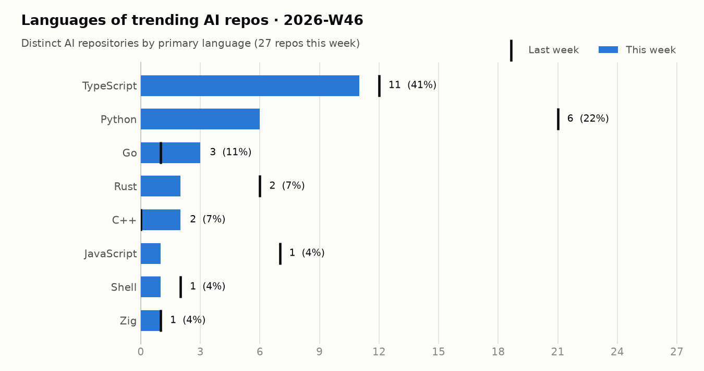
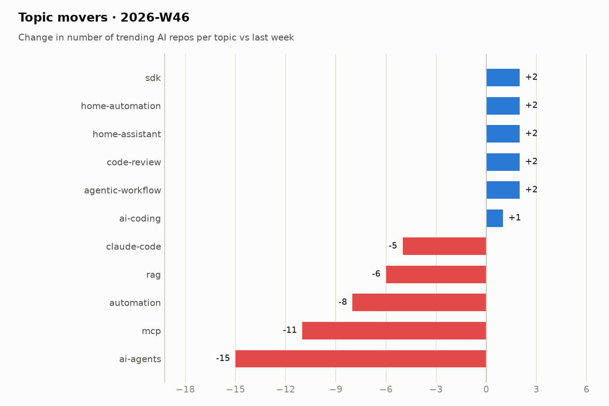

# Trending AI repos · 2026-W46

09 Nov 2026 – 15 Nov 2026

## Summary

- **27** distinct AI repos trended over 7 day(s) (last week: 58)
- AI share of all trending slots: **68%** (-5 pts vs last week)
- Dominant language: **TypeScript** (41% of AI repos)
- Rising topics: `agentic-workflow` (+2), `code-review` (+2), `home-assistant` (+2), `home-automation` (+2), `sdk` (+2)
- New this week: `home-assistant`, `home-automation`, `sdk`, `agentic-workflow`

## Languages

<picture><source media="(prefers-color-scheme: dark)" srcset="../../charts/2026-W46-languages-dark.png"></picture>

| Language | Repos | Share | Last week |
|---|--:|--:|--:|
| TypeScript | 11 | 41% | 12 |
| Python | 6 | 22% | 21 |
| Go | 3 | 11% | 1 |
| Rust | 2 | 7% | 6 |
| C++ | 2 | 7% | 0 |
| JavaScript | 1 | 4% | 7 |
| Shell | 1 | 4% | 2 |
| Zig | 1 | 4% | 1 |

## Topics

<picture><source media="(prefers-color-scheme: dark)" srcset="../../charts/2026-W46-topics-dark.png"></picture>

| Topic | Repos this week |
|---|--:|
| `claude-code` | 6 |
| `mcp` | 6 |
| `codex` | 5 |
| `ai-agents` | 4 |
| `agent-skills` | 3 |
| `claude` | 3 |
| `code-review` | 3 |
| `self-hosted` | 2 |
| `home-assistant` | 2 |
| `home-automation` | 2 |
| `ai-agent` | 2 |
| `cursor` | 2 |

## Most persistent AI repos

| Repo | Language | Days trending | Stars gained | Total stars |
|---|---|--:|--:|--:|
| [meta/astryx](https://github.com/meta/astryx) | TypeScript | 5 | 11,867 | 27,008 |
| [vercel-labs/agent-browser](https://github.com/vercel-labs/agent-browser) | Rust | 4 | 3,219 | 50,120 |
| [GoogleChrome/modern-web-guidance-src](https://github.com/GoogleChrome/modern-web-guidance-src) | TypeScript | 3 | 3,895 | 6,395 |
| [anthropics/skills](https://github.com/anthropics/skills) | Python | 3 | 3,509 | 192,717 |
| [addyosmani/agent-skills](https://github.com/addyosmani/agent-skills) | JavaScript | 3 | 2,068 | 116,931 |
| [homeassistant-ai/ha-mcp](https://github.com/homeassistant-ai/ha-mcp) | Python | 3 | 1,466 | 7,608 |
| [openai/codex-security](https://github.com/openai/codex-security) | TypeScript | 3 | 1,446 | 13,320 |
| [anthropics/claude-quickstarts](https://github.com/anthropics/claude-quickstarts) | Python | 3 | 1,114 | 20,676 |
| [ZhuLinsen/daily_stock_analysis](https://github.com/ZhuLinsen/daily_stock_analysis) | Python | 3 | 1,040 | 71,950 |
| [milind-soni/OpenMausBot](https://github.com/milind-soni/OpenMausBot) | TypeScript | 2 | 3,026 | 20,242 |
